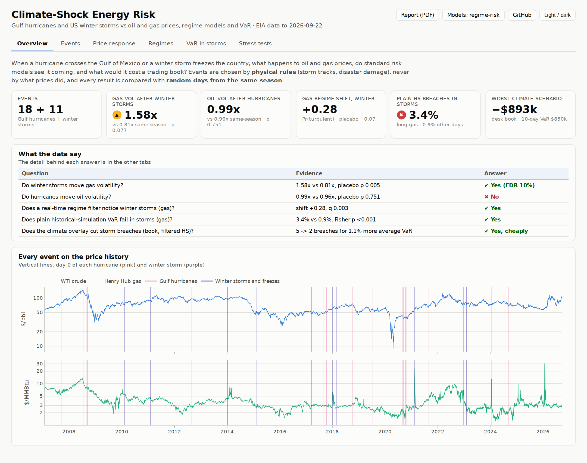
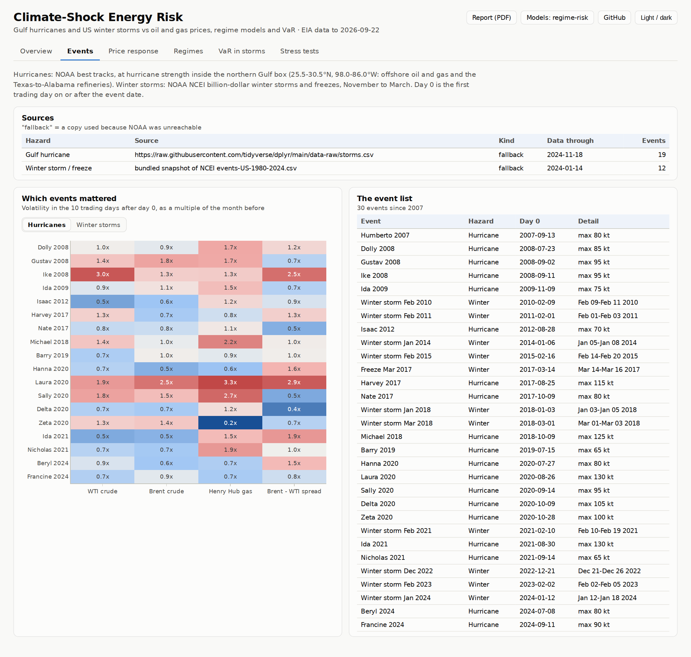
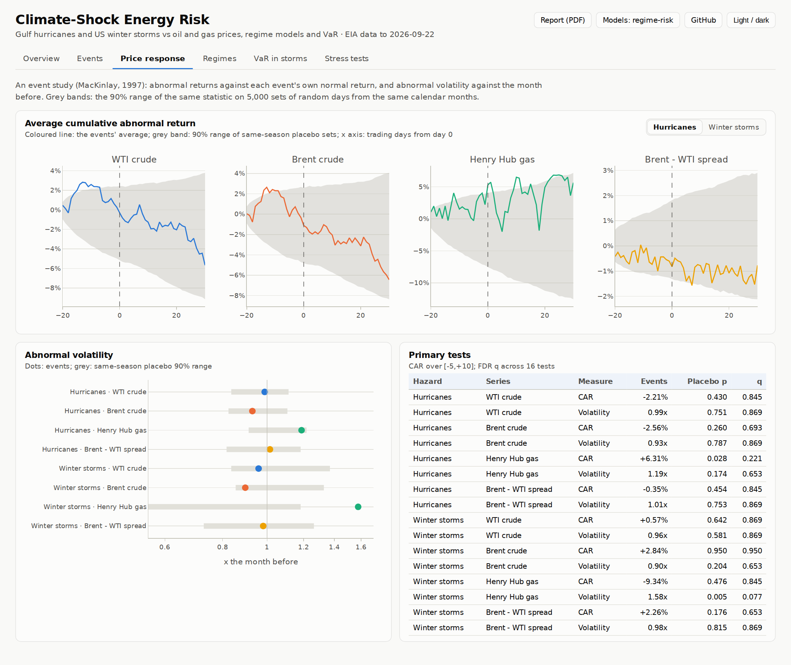
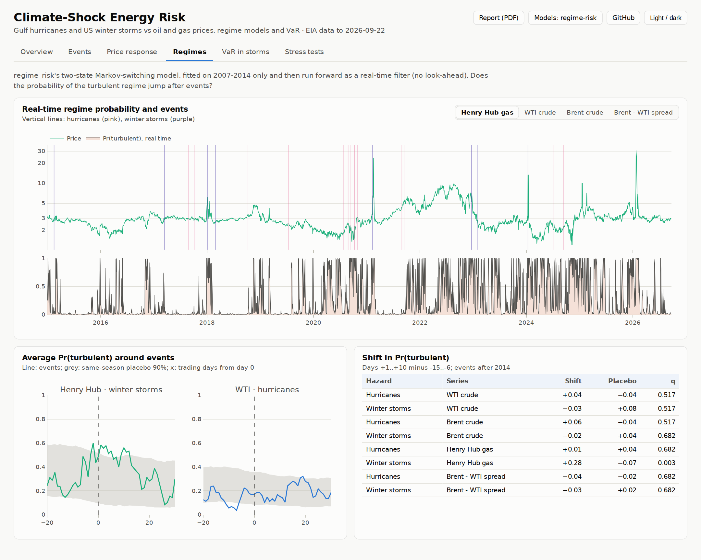
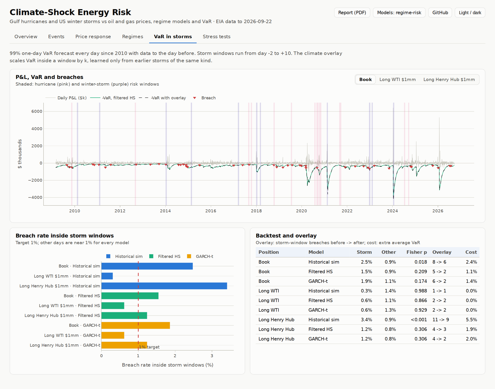
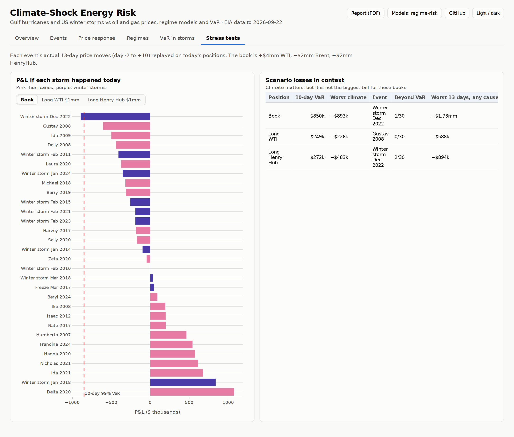

# Climate-Shock Energy Risk: Hurricanes, Winter Storms and the Risk Models That Should See Them

**📄 [View the PDF report](reports/climate_shock_energy_risk_report.pdf)** · **📊 [Open the live dashboard](https://n9omi.github.io/climate-shock-energy-risk/)** ([source](docs/index.html)) · 🧮 Models from [regime-risk-and-model-validation](https://github.com/n9omi/regime-risk-and-model-validation)

When a hurricane crosses the Gulf of Mexico or a winter storm freezes the country, what happens to oil and gas prices? Do the risk models a trading desk runs every day see it coming? And what would a repeat of each storm cost a book today? This project answers those three questions for WTI, Brent and Henry Hub from 2007 to today, with methods a risk or model-validation team would recognise: an event study with same-season placebo tests, a real-time Markov-switching regime filter, VaR backtests inside and outside storm windows, a climate overlay learned only from past storms, and historical-scenario stress tests.

**Two rules keep it honest:**
- **Events are picked by physical rules.** The rules are NOAA storm tracks and disaster damage, never what prices did, so the price response can be tested without circularity.
- **Every result is compared with random days from the same calendar months.** Hurricane season and winter are volatile anyway, and the comparison has to account for that.

**Built on a tested library.** All the statistical models come from [regime-risk-and-model-validation](https://github.com/n9omi/regime-risk-and-model-validation), installed as the Python package `regime_risk` rather than copied: Markov switching, EWMA and GARCH-t, historical and filtered-HS VaR, and the Kupiec and Christoffersen backtests. The report, dashboard and download code come from there too. This repository adds only what is new: the event catalogue, the event study, the overlay and the stress tests.

**Who it's for:**
- **Climate-risk and market-risk teams:** a worked example of translating physical climate hazards into market-risk terms. It shows which exposures react, whether VaR holds up, what an overlay costs, and what a scenario loses.
- **Model validators:** out-of-sample tests throughout, and a correction for multiple testing. Each design decision is written down and tested.
- **Students of energy markets:** a readable event study on real storms, with every number traceable to a CSV.

---

## Table of contents

- [Highlights](#highlights)
- [Dashboard](#dashboard)
- [The questions and how each is answered](#the-questions-and-how-each-is-answered)
- [How to use and run](#how-to-use-and-run)
- [Data sources](#data-sources)
- [Methods and notation](#methods-and-notation)
- [How this project uses regime-risk](#how-this-project-uses-regime-risk)
- [Repository layout](#repository-layout)
- [Design choices](#design-choices)
- [How to explain this project](#how-to-explain-this-project)
- [Limitations](#limitations)
- [References](#references)
- [Disclaimer](#disclaimer)

---

## Highlights

📄 **[Report (PDF)](reports/climate_shock_energy_risk_report.pdf)** · 📊 **[Live dashboard](https://n9omi.github.io/climate-shock-energy-risk/)** · web report: [outputs/climate_shock_energy_risk_report.md](outputs/climate_shock_energy_risk_report.md)

<!-- HIGHLIGHTS:START -->
*EIA data to 2026-09-22; generated 2026-09-28*

| Result | Value |
|---|---|
| Events | 18 Gulf hurricanes and 11 winter storms since 2008, chosen by NOAA storm tracks and damage, not prices |
| Gas after winter storms | volatility **1.58x** the month before vs 0.81x on same-season days (placebo p 0.005, FDR q 0.077) |
| Oil after hurricanes | volatility **0.99x** vs 0.96x on same-season days (p 0.751): no detectable effect |
| Regime filter, gas, winter | Pr(turbulent) **+0.28** after storms vs −0.07 on placebo dates (q 0.003) |
| VaR breaches in storm windows | plain HS, long gas: **3.4%** vs 0.9% elsewhere (p <0.001); filtered HS 1.2% |
| Climate overlay, desk book | filtered HS storm-window breaches **5 -> 2** for 1.1% more average VaR |
| Worst climate scenario, book | **−$893k** (Winter storm Dec 2022) vs 10-day 99% VaR $850k |

> Built with fallback copies of the NOAA event files (servers unreachable). `bash run.sh` re-downloads the official ones.
<!-- HIGHLIGHTS:END -->

---

## Dashboard

A static page (`docs/index.html`, published with GitHub Pages from `/docs`) with hover tooltips, per-hazard and per-position switches, light and dark themes, and a copy of the PDF one click away.

**Overview:** the headline answers, each with its evidence, and every event on the price history.


**Events:** where the events come from, the full list, and which storms mattered for each series.


**Price response:** average cumulative abnormal returns and abnormal volatility against the same-season placebo, and the primary test table.


**Regimes:** the real-time probability of the turbulent regime with every event marked, and its average path around events.


**VaR in storms:** P&L, VaR, the climate overlay and breaches for each position; breach rates inside storm windows.


**Stress tests:** what each past storm's price moves would do to today's book, against 10-day VaR and the worst stretch of any cause.


---

## The questions and how each is answered

| # | Question | Method | Test | Script |
|---|---|---|---|---|
| 1 | Which events? | NOAA best tracks: hurricane strength inside the northern Gulf box. NOAA NCEI billion-dollar winter storms and freezes, November to March | Rules fixed in `config.py` before looking at prices | `pipeline/01_data.py` |
| 2 | Do prices move? | Event study: cumulative abnormal return (direction) and abnormal volatility (size) | t-test, sign test, **month-matched placebo** (5,000 sets); Benjamini–Hochberg FDR across the 16 primary tests | `pipeline/02_event_study.py` |
| 3 | Do regime models notice? | 2-state Markov switching fitted to 2014, then run as a real-time filter | Shift in Pr(turbulent) vs placebo, events after 2014 only | `pipeline/03_regimes.py` |
| 4 | Does VaR hold up in storms? | Historical simulation, filtered HS (EWMA), GARCH-t; 99% one-day, from 2010 | Fisher's exact test (storm windows vs other days), Kupiec on window days | `pipeline/04_var.py` |
| 4b | Does a climate overlay help? | Scale VaR in storm windows by k learned from **earlier** storms only | Breaches before and after, extra average VaR | `pipeline/04_var.py` |
| 5 | What would a repeat cost? | Historical scenarios: each storm's 13-day moves applied to today's positions | Against 10-day 99% VaR and the worst 13 days of any cause | `pipeline/05_stress.py` |

---

## How to use and run

**Prerequisites:** Python 3.11+, an internet connection on the first run, and Chrome or Edge for the PDF and screenshots (setup installs a small Chromium otherwise). No accounts or keys.

```bash
git clone https://github.com/n9omi/climate-shock-energy-risk.git
cd climate-shock-energy-risk
bash setup.sh          # once: virtual environment, packages, and the regime_risk models
bash run.sh            # data and events, all five steps, report, dashboard, screenshots, tests (~2 minutes)
open docs/index.html   # the dashboard (macOS; elsewhere open it in any browser)
```

- **Where the models come from:** `setup.sh` installs `regime_risk`. If a `regime-risk-and-model-validation` folder sits next to this one, it installs that copy in editable mode, so changes to the models show up here immediately. Otherwise it installs from GitHub.
- **One step:** `.venv/bin/python pipeline/03_regimes.py` (steps hand off through `data/processed/`, so after one full run any step can be rerun alone).
- **Change the study:** everything lives in `config.py`: the Gulf box, the hurricane threshold, the winter months, the event windows, the placebo count, the positions, the VaR settings and the overlay cap.
- **Tests:** `.venv/bin/python -m pytest -q` runs 19 offline checks: the event rules on hand-made storms, known-answer tests for every statistic, a planted-effect test for the placebo, and a no-look-ahead test for the overlay.
- **Optional FRED API key:** copy `.env.example` to `.env` and add `FRED_API_KEY=...` (never committed). Without it the public CSV is used.

| After running, open | Contents |
|---|---|
| `reports/climate_shock_energy_risk_report.pdf` | The report |
| `docs/index.html` | The dashboard |
| `outputs/tables/*.csv` | Every number, per event and per test |
| `outputs/figures/*.png` | The report's figures |

---

## Data sources

All free and public.

| Source | Used for | Notes |
|---|---|---|
| EIA daily spot prices via FRED (`DCOILWTICO`, `DCOILBRENTEU`, `DHHNGSP`); GitHub mirror as fallback | Returns, P&L, VaR | From 2007, when all three series are complete; cleaned with regime_risk's logged data-quality rules (e.g. the negative WTI print of April 2020 is set to missing) |
| [NOAA NHC best-track data (HURDAT2)](https://www.nhc.noaa.gov/data/#hurdat) | Hurricanes | 6-hourly positions and winds. The newest file is picked from NHC's listing; dplyr's published copy (1975-2024) is the fallback |
| [NOAA NCEI Billion-Dollar Weather and Climate Disasters](https://www.ncei.noaa.gov/access/billions/) | Winter storms | Event names and dates. NOAA stopped updating it in 2025; a snapshot of the winter rows ships as a fallback |

`outputs/tables/01_events_log.csv` records which source each run used. The README highlights, report and dashboard say so if a fallback was used.

---

## Methods and notation

Returns $r_t = 100\ln(P_t/P_{t-1})$. For an event with day 0 at trading day $p$:

$$\hat\mu = \frac{1}{230}\sum_{\tau=-250}^{-21} r_{p+\tau}, \qquad AR_\tau = r_{p+\tau}-\hat\mu, \qquad CAR[a,b]=\sum_{\tau=a}^{b} AR_\tau$$

$$AV = \ln\frac{\text{RMS}(r_{p},\dots,r_{p+10})}{\text{RMS}(r_{p-30},\dots,r_{p-11})} \qquad (0 = \text{no change},\ \ln 2 = \text{doubled})$$

- **Placebo test.** Each event gets a stand-in from the same calendar month, at least 30 trading days from any real event; 5,000 such sets give the distribution of the average under "an ordinary day in the same season". Two-sided $p$ = the share of placebo averages at least as extreme.
- **False discoveries.** Benjamini–Hochberg $q$-values across the 16 primary tests (full-window CAR and abnormal volatility; 2 hazards × 4 series).
- **Regimes.** $r_t \mid s_t \sim N(\mu_{s}, \sigma_{s}^2)$ with a 2-state Markov chain; the Hamilton filter gives $\Pr(s_t=\text{turbulent}\mid r_1..r_t)$ with parameters fixed from 2007–2014.
- **VaR.** $\text{VaR}_t$ is a positive loss forecast made with data to $t-1$. A breach is $x_t < -\text{VaR}_t$. HS uses the 1% quantile of the last 500 P&Ls, FHS the same on EWMA-standardised P&L, and GARCH-t the Student-t quantile of the GARCH variance.
- **Climate overlay.** Inside event $j$'s window $[-2,+10]$, $\text{VaR}^*_t = k_j\,\text{VaR}_t$ with

$$k_j = \text{clip}\left(\sqrt{\frac{\sum x_t^2}{\sum(\text{VaR}_t/2.326)^2}},\ 1,\ 3\right)$$

over earlier windows of the same hazard, using only days before window $j$ opens.

- **Stress.** $\text{P\&L}_e = \sum_i N_i\left(e^{\sum_{\tau=-2}^{10} r_{i,p_e+\tau}/100}-1\right)$ for today's notionals $N_i$.

---

## How this project uses regime-risk

[regime-risk-and-model-validation](https://github.com/n9omi/regime-risk-and-model-validation) has a `pyproject.toml` that installs its `lib/` folder as the package `regime_risk`. Here, `climrisk/rr.py` imports it (or loads it from a sibling folder if it is not installed) and the scripts use it like any library:

| From `regime_risk` | Used for |
|---|---|
| `data.daily_series`, `data.clean_daily`, `fetch.fetch` | Downloading EIA prices with fallbacks and caching; logged data-quality rules |
| `regimes.fit`, `regimes.filter_fixed` | Markov-switching fit on 2007–2014 and the real-time filter afterwards |
| `volatility.ewma`, `volatility.garch_fit`, `volatility.garch_filter` | Filtered HS and GARCH-t VaR |
| `var_es.t_var_es`, `var_es.kupiec_pof`, `var_es.conditional_coverage` | VaR quantiles and backtests |
| `report.Report`, `dashboard.Dashboard`, `style` | The PDF, the dashboard and the chart style |

Because nothing is copied, fixing or improving a model in regime-risk improves this project on the next `bash setup.sh`, and `tests/test_methods.py` checks that the models still behave.

---

## Repository layout

```
climate-shock-energy-risk/
├── README.md, config.py, setup.sh, run.sh, requirements.txt, pytest.ini, .env.example
├── pipeline/
│   ├── 01_data.py          prices (EIA) and the event catalogue (NOAA), aligned to trading days
│   ├── 02_event_study.py   CARs, abnormal volatility, t / sign / placebo tests, FDR
│   ├── 03_regimes.py       real-time Markov-switching filter around events
│   ├── 04_var.py           VaR backtests inside and outside storm windows; the climate overlay
│   └── 05_stress.py        historical climate scenarios on today's positions
├── climrisk/               the project's own code (small)
│   ├── rr.py               imports the regime_risk models
│   ├── events.py           HURDAT2 and NCEI parsers, the Gulf-box and winter rules, trading-day alignment
│   ├── eventstudy.py       abnormal returns and volatility, placebo, sign test, Benjamini-Hochberg
│   ├── overlay.py          HS / FHS / GARCH-t VaR paths and the look-ahead-free overlay
│   ├── colors.py, readme.py
│   └── ncei_winter_snapshot.csv   fallback copy of NOAA's winter-storm rows
├── make_report.py          the PDF (also refreshes the README highlights)
├── make_dashboard.py       docs/index.html, a copy of the PDF, and the screenshots
├── tests/                  19 offline tests
├── outputs/                tables/ and figures/
├── reports/                the PDF
└── docs/                   the dashboard (GitHub Pages)
```

---

## Design choices

- **Physical event rules, fixed in advance.** Picking "the storms that moved prices" would guarantee a finding. The Gulf box and wind threshold, and NOAA's own damage threshold, decide instead.
- **Same-season placebo, not "any day".** August–October and December–February are more volatile than average, so ordinary days in those months are the right comparison.
- **Volatility against the month before, not the whole year.** A year-long baseline would compare the 2020 hurricanes with the COVID crash in the spring and make them look calm. The first version of this study had exactly that bias, and it is why the baseline changed.
- **Real-time everything.** The regime filter uses parameters fitted before the events it scores. VaR uses data to the day before. The overlay learns only from earlier storms.
- **Primary tests declared, the rest descriptive.** Sixteen primary tests carry an FDR correction, and the other windows are shown but not claimed.
- **Honest scale.** The stress test compares climate losses with the worst 13 days of any cause, so climate risk is neither dismissed nor overstated.

---

## How to explain this project

> "I wanted to know whether physical climate events show up in energy market risk, and whether standard risk models cope. I picked events by physical rules: every hurricane at hurricane strength in the Gulf production area from NOAA's storm tracks, and every billion-dollar winter storm from NOAA's disaster database. I ran an event study on WTI, Brent and Henry Hub, testing each event against random days from the same season. Hurricanes, despite the headlines, leave no detectable mark on crude volatility. Winter storms are a gas story: a handful of cold snaps, like February 2021 and January 2024, multiplied Henry Hub volatility many times over. A real-time regime filter picks those up; plain historical-simulation VaR breaches several times too often during them, while filtered-HS and GARCH models mostly cope. A simple overlay that scales VaR during storm windows, learned only from earlier storms, cuts those breaches for about one to two percent more average VaR. The models themselves come from my regime-risk library, imported as a package, so this project is only the new analysis."

**Follow-up questions to prepare for:**
- **Why not use landfall dates?** Energy disruption starts when platforms evacuate, before landfall. Entering the production box is closer to when supply is lost, and the run-up window catches the anticipation.
- **Isn't 11 winter storms too few?** Yes, for an average, which is why the answer rests on the placebo distribution and the per-event table, and why the finding is described as "a few extreme cold snaps" rather than "every storm".
- **Why does plain HS fail when FHS doesn't?** HS weights the last 500 days equally, so a sudden jump in volatility barely moves it. FHS and GARCH rescale by today's volatility, so a storm that starts with a few big moves raises VaR within days.
- **Would the overlay work in practice?** It assumes about two days' warning, which NHC and NWS watches usually give. It is an add-on to a volatility-updating model, not a fix for a static one.

---

## Limitations

- **Spot, not futures.** Spot Henry Hub reacts to same-day weather more than front-month futures, so the gas results overstate what a futures book would see.
- **Physical dates are not information dates.** Forecasts move prices days before a storm arrives. The run-up window and the risk window starting at day −2 only partly capture that.
- **No winter storms after 2024.** NOAA stopped updating the billion-dollar database in 2025. That misses the late-January 2026 cold snap (see [EIA](https://www.eia.gov/todayinenergy/detail.php?id=67046)), which produced the worst 13 days for a long gas position in the whole sample.
- **Small samples.** 18 hurricanes and 11 winter storms with full windows, so one event can move an average.
- **A US Gulf view.** Hurricanes elsewhere, heat waves, droughts (river freight, hydro) and wildfires are out of scope.

---

## References

- MacKinlay, A. C. (1997). Event studies in economics and finance. *Journal of Economic Literature*, 35(1).
- Brown, S. & Warner, J. (1985). Using daily stock returns: the case of event studies. *Journal of Financial Economics*, 14(1).
- Benjamini, Y. & Hochberg, Y. (1995). Controlling the false discovery rate. *JRSS B*, 57(1).
- Hamilton, J. (1989). A new approach to the economic analysis of nonstationary time series and the business cycle. *Econometrica*, 57(2).
- Barone-Adesi, G., Giannopoulos, K. & Vosper, L. (1999). VaR without correlations for portfolios of derivative securities. *Journal of Futures Markets*, 19(5).
- Bollerslev, T. (1987). A conditionally heteroskedastic time series model for speculative prices and rates of return. *Review of Economics and Statistics*, 69(3).
- Kupiec, P. (1995). Techniques for verifying the accuracy of risk measurement models. *Journal of Derivatives*, 3(2).
- Landsea, C. & Franklin, J. (2013). Atlantic hurricane database uncertainty and presentation of a new database format (HURDAT2). *Monthly Weather Review*, 141(10).
- Smith, A. & Katz, R. (2013). US billion-dollar weather and climate disasters: data sources, trends, accuracy and biases. *Natural Hazards*, 67(2).

---

## Disclaimer

Educational and research project. Positions are hypothetical and nothing here is investment advice. Data are from public sources and may contain errors; check them before relying on any number.
