# Climate-Shock Energy Risk

*How Gulf hurricanes and US winter storms move oil and gas prices, and whether risk models see them coming · EIA data to 2026-09-22 · generated 2026-09-28*

## Headline numbers

| Metric | Value | Context |
|---|---|---|
| Events tested | **18 + 11** | Gulf hurricanes + winter storms with a full year of prior data |
| Gas volatility after winter storms | **1.58x** | of the month before; same-season days 0.81x (q = 0.077) |
| Oil volatility after hurricanes | **0.99x** | same-season days 0.96x (p = 0.751) |
| Henry Hub regime shift, winter | **+0.28** | change in Pr(turbulent); placebo −0.07 |
| Plain HS VaR in storms (gas) | **3.4%** | breach rate vs 0.9% on other days (target 1%) |
| Worst climate scenario, book | **−$893k** | Winter storm Dec 2022; 10-day VaR $850k |

- **Winter storms are a gas-volatility event; the average move hides a fat tail.** In the ten trading days after a winter storm, Henry Hub volatility averaged 1.58x its level in the month before, against 0.81x on random days in the same months (placebo p 0.005, FDR q 0.077). Most storms barely register: the average is driven by Winter storm Jan 2024 (15x), Winter storm Feb 2021 (13x), Winter storm Jan 2018 (7x).
- **Hurricanes do not move oil the way headlines suggest.** Across 18 Gulf hurricanes, crude volatility after landfall was 0.99x the month before (same-season days: 0.96x; p 0.751), and no average price move survives a same-season placebo test after correcting for 16 tests (smallest q 0.22).
- **A regime model notices winter storms in real time.** A two-state Markov-switching model fitted only on data to 2014 and then run as a live filter raised its probability of the turbulent regime for Henry Hub by +0.28 after winter storms, against −0.07 on placebo dates (q 0.003). It shows no such shift for hurricanes in any series.
- **The VaR model that fails in storms is the one that does not update volatility.** Plain historical simulation breached on 3.4% of storm-window days for a long gas position, against 0.9% elsewhere (Fisher p <0.001). Filtered HS and GARCH-t, which re-weight to recent volatility every day, stayed near 1.2% (p 0.306).
- **A climate overlay learned only from past storms cuts storm-window breaches cheaply.** For the desk book it takes filtered-HS breaches in storm windows from 5 to 2 and GARCH-t from 6 to 2, for 1.1% and 1.4% more average VaR. It cannot rescue plain HS in the extreme cold snaps, which lost up to 4x VaR in a day.
- **Stress test:** replaying each storm's 13-day price moves on today's book, the worst case is Winter storm Dec 2022 at −$893k (1 of 30 scenarios exceed today's 10-day 99% VaR of $850k). The worst 13 days of the whole sample, ending 2020-03-30, cost −$1.73mm: climate is a real but not the dominant source of tail risk for this book.

> **Note:** Events are picked by physical rules (a storm's track and winds; a disaster's damage), never by what prices did, and every test compares events with random days from the same calendar months, because hurricane season and winter are volatile anyway.

> **Caveat:** This build used fallback copies of the event data (hurricane: https://raw.githubusercontent.com/tidyverse/dplyr/main/data-raw/storms.csv; winter: bundled snapshot of NCEI events-US-1980-2024.csv) because the NOAA servers were unreachable. `bash run.sh` re-downloads the official files.

## 1. The events

**Hurricanes** come from NOAA's best-track database (HURDAT2): a storm counts if it is at hurricane strength (at least 64 knots) while inside the northern Gulf box 25.5-30.5°N, 98.0-86.0°W, which covers the federal offshore oil and gas fields and the Texas-to-Alabama refining coast. Day 0 is the first date it is there. **Winter storms** come from NOAA NCEI's billion-dollar disaster list: every "Winter Storm" or "Freeze" that began between November and March, with episodes less than a week apart merged. Day 0 is the first trading day on or after the event date.

**Where the events come from**

| Hazard | Source | Data through | Events | Rule |
|---|---|---|---|---|
| hurricane | https://raw.githubusercontent.com/tidyverse/dplyr/main/data-raw/storms.csv | 2024-11-18 | 19 | status HU, >= 64 kt, lat (25.5, 30.5), lon (-98.0, -86.0) |
| winter | bundled snapshot of NCEI events-US-1980-2024.csv | 2024-01-14 | 12 | Winter Storm or Freeze, starting in months (11, 12, 1, 2, 3), merged within 7 days |

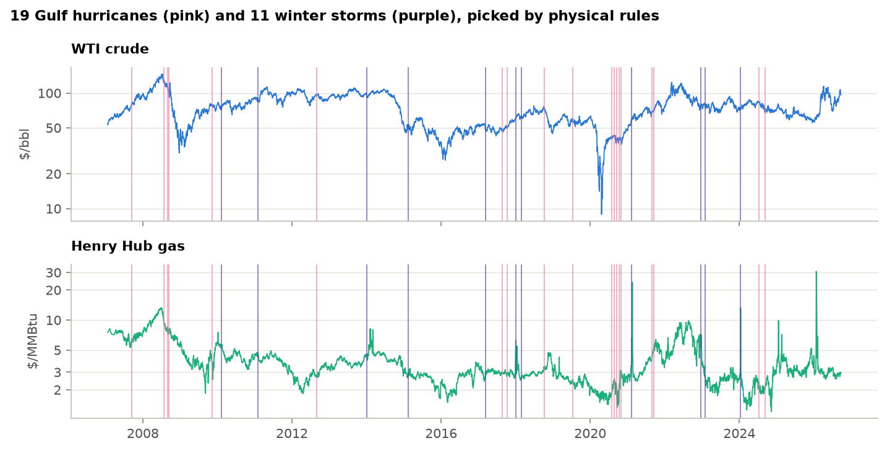

*Every event on the WTI and Henry Hub price history.*

**The event list**

| Event | Hazard | Date | Day 0 | Detail |
|---|---|---|---|---|
| Humberto 2007 | Gulf hurricane | 2007-09-13 | 2007-09-13 | max 80 kt in the Gulf box, 3 six-hourly fixes |
| Dolly 2008 | Gulf hurricane | 2008-07-23 | 2008-07-23 | max 85 kt in the Gulf box, 6 six-hourly fixes |
| Gustav 2008 | Gulf hurricane | 2008-08-31 | 2008-09-02 | max 95 kt in the Gulf box, 6 six-hourly fixes |
| Ike 2008 | Gulf hurricane | 2008-09-11 | 2008-09-11 | max 95 kt in the Gulf box, 10 six-hourly fixes |
| Ida 2009 | Gulf hurricane | 2009-11-09 | 2009-11-09 | max 75 kt in the Gulf box, 2 six-hourly fixes |
| Winter storm Feb 2010 | Winter storm / freeze | 2010-02-09 | 2010-02-09 | NCEI billion-dollar event, Feb 09-Feb 11 2010 |
| Winter storm Feb 2011 | Winter storm / freeze | 2011-02-01 | 2011-02-01 | NCEI billion-dollar event, Feb 01-Feb 03 2011 |
| Isaac 2012 | Gulf hurricane | 2012-08-28 | 2012-08-28 | max 70 kt in the Gulf box, 7 six-hourly fixes |
| Winter storm Jan 2014 | Winter storm / freeze | 2014-01-05 | 2014-01-06 | NCEI billion-dollar event, Jan 05-Jan 08 2014 |
| Winter storm Feb 2015 | Winter storm / freeze | 2015-02-14 | 2015-02-16 | NCEI billion-dollar event, Feb 14-Feb 20 2015 |
| Freeze Mar 2017 | Winter storm / freeze | 2017-03-14 | 2017-03-14 | NCEI billion-dollar event, Mar 14-Mar 16 2017 |
| Harvey 2017 | Gulf hurricane | 2017-08-25 | 2017-08-25 | max 115 kt in the Gulf box, 7 six-hourly fixes |
| Nate 2017 | Gulf hurricane | 2017-10-07 | 2017-10-09 | max 80 kt in the Gulf box, 4 six-hourly fixes |
| Winter storm Jan 2018 | Winter storm / freeze | 2018-01-03 | 2018-01-03 | NCEI billion-dollar event, Jan 03-Jan 05 2018 |
| Winter storm Mar 2018 | Winter storm / freeze | 2018-03-01 | 2018-03-01 | NCEI billion-dollar event, Mar 01-Mar 03 2018 |
| Michael 2018 | Gulf hurricane | 2018-10-09 | 2018-10-09 | max 125 kt in the Gulf box, 4 six-hourly fixes |
| Barry 2019 | Gulf hurricane | 2019-07-13 | 2019-07-15 | max 65 kt in the Gulf box, 2 six-hourly fixes |
| Hanna 2020 | Gulf hurricane | 2020-07-25 | 2020-07-27 | max 80 kt in the Gulf box, 5 six-hourly fixes |
| Laura 2020 | Gulf hurricane | 2020-08-26 | 2020-08-26 | max 130 kt in the Gulf box, 5 six-hourly fixes |
| Sally 2020 | Gulf hurricane | 2020-09-14 | 2020-09-14 | max 95 kt in the Gulf box, 10 six-hourly fixes |
| Delta 2020 | Gulf hurricane | 2020-10-09 | 2020-10-09 | max 105 kt in the Gulf box, 5 six-hourly fixes |
| Zeta 2020 | Gulf hurricane | 2020-10-28 | 2020-10-28 | max 100 kt in the Gulf box, 4 six-hourly fixes |
| Winter storm Feb 2021 | Winter storm / freeze | 2021-02-10 | 2021-02-10 | NCEI billion-dollar event, Feb 10-Feb 19 2021 |
| Ida 2021 | Gulf hurricane | 2021-08-28 | 2021-08-30 | max 130 kt in the Gulf box, 7 six-hourly fixes |
| Nicholas 2021 | Gulf hurricane | 2021-09-14 | 2021-09-14 | max 65 kt in the Gulf box, 3 six-hourly fixes |
| Winter storm Dec 2022 | Winter storm / freeze | 2022-12-21 | 2022-12-21 | NCEI billion-dollar event, Dec 21-Dec 26 2022 |
| Winter storm Feb 2023 | Winter storm / freeze | 2023-02-02 | 2023-02-02 | NCEI billion-dollar event, Feb 02-Feb 05 2023 |
| Winter storm Jan 2024 | Winter storm / freeze | 2024-01-12 | 2024-01-12 | NCEI billion-dollar event, Jan 12-Jan 18 2024 |
| Beryl 2024 | Gulf hurricane | 2024-07-08 | 2024-07-08 | max 80 kt in the Gulf box, 3 six-hourly fixes |
| Francine 2024 | Gulf hurricane | 2024-09-11 | 2024-09-11 | max 90 kt in the Gulf box, 6 six-hourly fixes |

## 2. Price response: an event study

For each event, the normal return is the average over trading days -250 to -21. Abnormal returns are deviations from it, summed into a cumulative abnormal return (CAR) for direction. Abnormal volatility compares the ten days after day 0 with the month before, for size. Each average is tested three ways: a t-test across events, a sign test, and a placebo that repeats the calculation on 5,000 random sets of dates from the same calendar months with no event within 30 trading days. Benjamini-Hochberg q-values control the false-discovery rate across the 16 primary tests.

**Primary tests: CAR over [-5,+10] and abnormal volatility over [0,+10]**

| Hazard | Series | Measure | Events | Placebo | t-test p | Placebo p | q (FDR) |
|---|---|---|---|---|---|---|---|
| Gulf hurricane | WTI crude | Full CAR | -2.21% | -0.71% | 0.328 | 0.430 | 0.845 |
| Gulf hurricane | WTI crude | Abnormal volatility | 0.99x | 0.96x | 0.917 | 0.751 | 0.869 |
| Gulf hurricane | Brent crude | Full CAR | -2.56% | -0.46% | 0.308 | 0.260 | 0.693 |
| Gulf hurricane | Brent crude | Abnormal volatility | 0.93x | 0.95x | 0.477 | 0.787 | 0.869 |
| Gulf hurricane | Henry Hub gas | Full CAR | +6.31% | -1.11% | 0.200 | 0.028 | 0.221 |
| Gulf hurricane | Henry Hub gas | Abnormal volatility | 1.19x | 1.05x | 0.261 | 0.174 | 0.653 |
| Gulf hurricane | Brent - WTI spread | Full CAR | -0.35% | +0.25% | 0.663 | 0.454 | 0.845 |
| Gulf hurricane | Brent - WTI spread | Abnormal volatility | 1.01x | 0.98x | 0.914 | 0.753 | 0.869 |
| Winter storm / freeze | WTI crude | Full CAR | +0.57% | +2.09% | 0.808 | 0.642 | 0.869 |
| Winter storm / freeze | WTI crude | Abnormal volatility | 0.96x | 1.05x | 0.501 | 0.581 | 0.869 |
| Winter storm / freeze | Brent crude | Full CAR | +2.84% | +2.17% | 0.283 | 0.950 | 0.950 |
| Winter storm / freeze | Brent crude | Abnormal volatility | 0.90x | 1.06x | 0.235 | 0.204 | 0.653 |
| Winter storm / freeze | Henry Hub gas | Full CAR | -9.34% | -4.77% | 0.307 | 0.476 | 0.845 |
| Winter storm / freeze | Henry Hub gas | Abnormal volatility | 1.58x | 0.81x | 0.292 | 0.005 | 0.077 |
| Winter storm / freeze | Brent - WTI spread | Full CAR | +2.26% | +0.08% | 0.160 | 0.176 | 0.653 |
| Winter storm / freeze | Brent - WTI spread | Abnormal volatility | 0.98x | 0.95x | 0.853 | 0.815 | 0.869 |

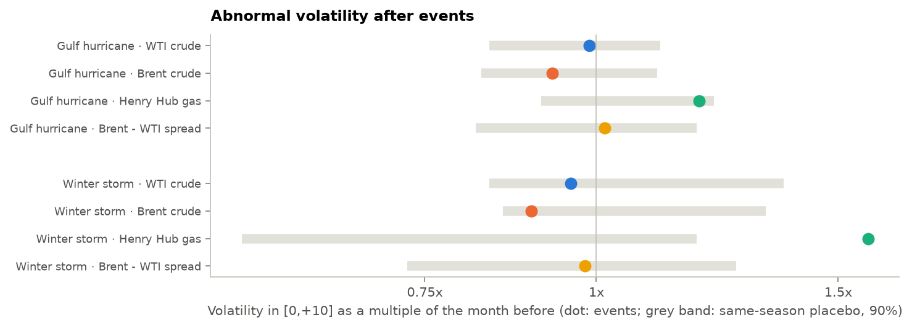

*Volatility after events as a multiple of the month before, against the same-season placebo range.*

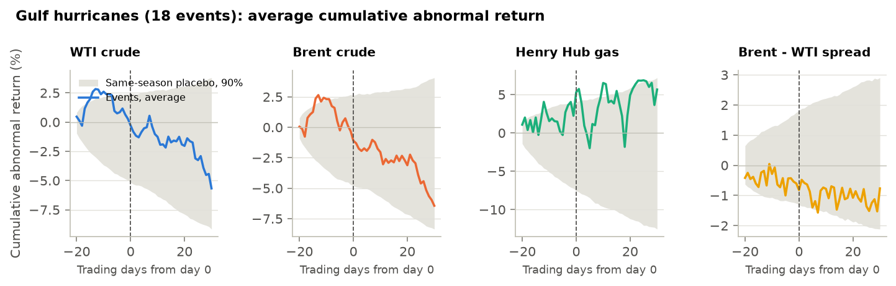

*Hurricanes: average cumulative abnormal return; grey = 90% range of same-season placebo sets.*

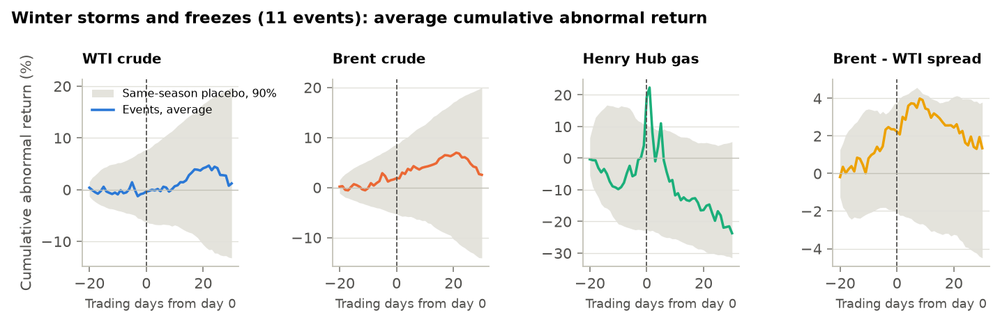

*Winter storms: average cumulative abnormal return.*

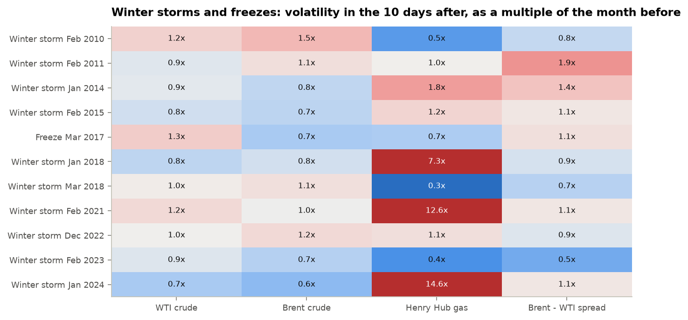

*Winter storms, one row each: most barely register; a few multiply gas volatility.*

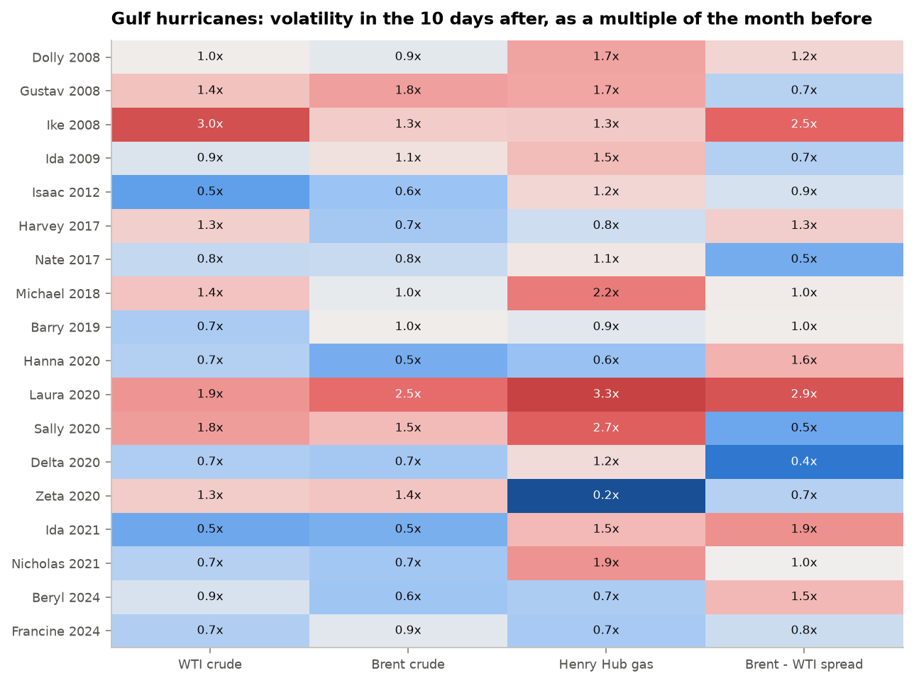

*Hurricanes, one row each.*

## 3. Do regime models notice?

regime_risk's two-state Markov-switching model is fitted on 2007-2014 only, then run forward as a real-time Hamilton filter with fixed parameters. The shift is the average probability of the turbulent regime over days 1 to +10 minus days -15 to -6, for events after the training period.

**Fitted regimes (annualised volatility, expected spell length)**

| Series | Calm vol | Turbulent vol | Calm spell (days) | Turbulent spell (days) |
|---|---|---|---|---|
| WTI crude | 25% | 77% | 79 | 13 |
| Brent crude | 21% | 53% | 48 | 18 |
| Henry Hub gas | 42% | 155% | 67 | 8 |
| Brent - WTI spread | 20% | 67% | 38 | 8 |

**Change in the real-time probability of the turbulent regime**

| Hazard | Series | Events | Shift | Placebo shift | p | q (FDR) |
|---|---|---|---|---|---|---|
| Gulf hurricane | WTI crude | 13 | +0.04 | −0.04 | 0.253 | 0.517 |
| Winter storm / freeze | WTI crude | 8 | −0.03 | +0.08 | 0.241 | 0.517 |
| Gulf hurricane | Brent crude | 13 | +0.06 | −0.04 | 0.259 | 0.517 |
| Winter storm / freeze | Brent crude | 8 | −0.02 | +0.04 | 0.551 | 0.682 |
| Gulf hurricane | Henry Hub gas | 13 | +0.01 | +0.04 | 0.559 | 0.682 |
| Winter storm / freeze | Henry Hub gas | 8 | +0.28 | −0.07 | <0.001 | 0.003 |
| Gulf hurricane | Brent - WTI spread | 13 | −0.04 | −0.02 | 0.682 | 0.682 |
| Winter storm / freeze | Brent - WTI spread | 8 | −0.03 | +0.02 | 0.635 | 0.682 |

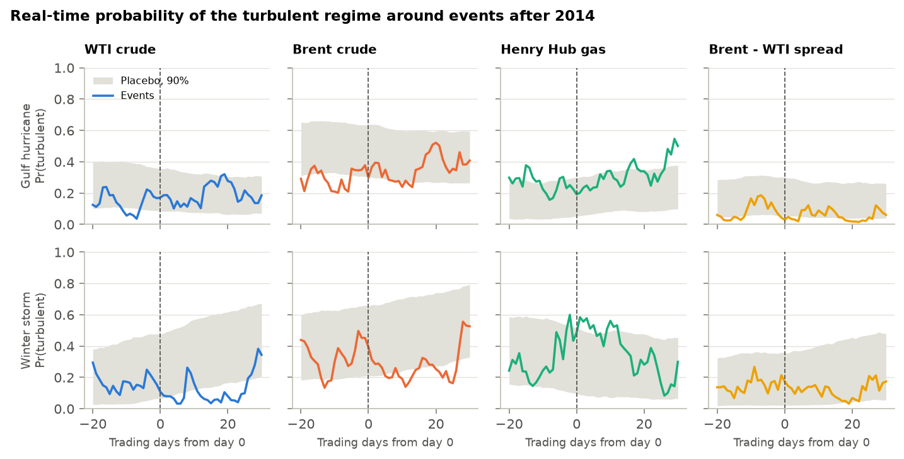

*Average real-time probability of the turbulent regime around events, with the placebo range.*

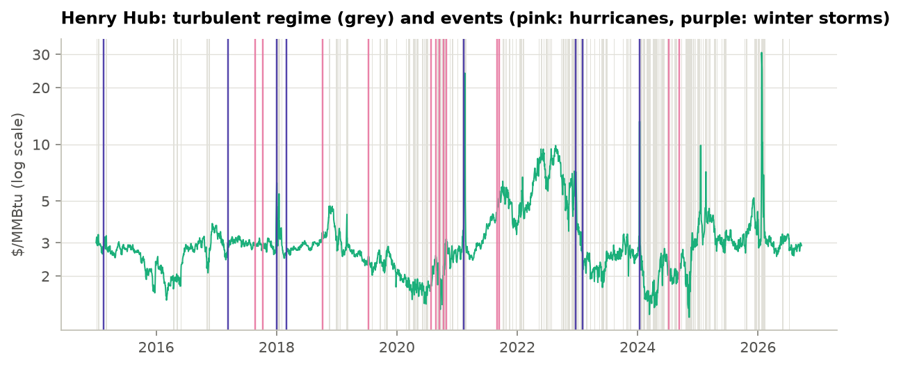

*Henry Hub since 2015: turbulent regime (grey) and events.*

## 4. VaR in storms, and a climate overlay

Three 99% one-day VaR models from regime_risk and climrisk.overlay forecast every day from 2010 using data up to the day before: historical simulation (500 days), filtered HS (EWMA 0.94) and GARCH(1,1)-t re-estimated every 250 days. A storm's risk window runs from -2 to +10 trading days around day 0 (hurricane and winter-storm watches give about two days' warning). The overlay multiplies VaR inside a window by k, the ratio of realised to model-implied volatility in earlier storms of the same kind (only days before the window opens), capped at 3 and switched on after 2 past events.

**Breach rates (target 1%); 323 storm-window days in the backtest**

| Position | Model | All days | Storm windows | Other days | Fisher p | Storm breaches, then with overlay | Extra avg VaR |
|---|---|---|---|---|---|---|---|
| Book | Historical sim | 1.05% | 2.48% | 0.94% | 0.018 | 8 -> 6 | 2.4% |
| Book | Filtered HS | 0.98% | 1.55% | 0.94% | 0.209 | 5 -> 2 | 1.1% |
| Book | GARCH-t | 1.17% | 1.86% | 1.12% | 0.174 | 6 -> 2 | 1.4% |
| Long WTI | Historical sim | 1.31% | 0.31% | 1.39% | 0.988 | 1 -> 1 | 0.0% |
| Long WTI | Filtered HS | 1.05% | 0.62% | 1.09% | 0.866 | 2 -> 2 | 0.0% |
| Long WTI | GARCH-t | 1.29% | 0.62% | 1.34% | 0.929 | 2 -> 2 | 0.0% |
| Long Henry Hub | Historical sim | 1.08% | 3.41% | 0.89% | <0.001 | 11 -> 9 | 5.5% |
| Long Henry Hub | Filtered HS | 0.87% | 1.24% | 0.84% | 0.306 | 4 -> 3 | 1.9% |
| Long Henry Hub | GARCH-t | 0.87% | 1.24% | 0.84% | 0.306 | 4 -> 2 | 2.0% |

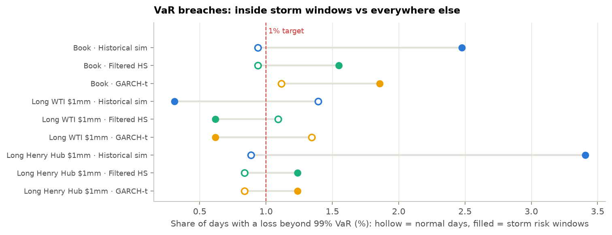

*Breach rates inside storm windows (filled) and on other days (hollow).*

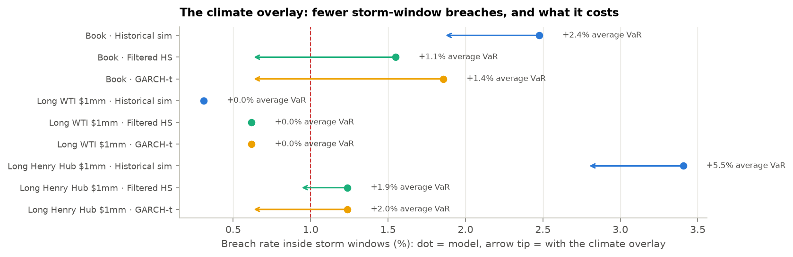

*The overlay: storm-window breach rate before (dot) and after (arrow tip), with its cost in average VaR.*

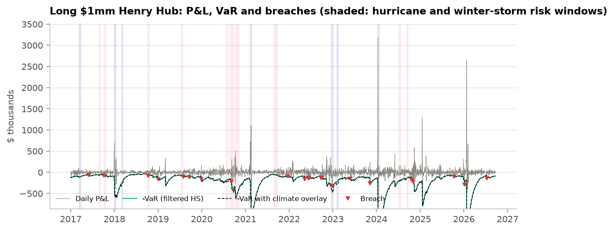

*A long Henry Hub position: P&L, filtered-HS VaR, the overlay and breaches.*

## 5. Climate stress tests

Each event's actual 13-day price changes (day -2 to +10) applied to today's positions: +$4mm WTI, -$2mm Brent, +$2mm HenryHub for the book. The 10-day VaR is the square-root-of-time scaling of today's one-day filtered-HS VaR.

**Scenario losses in context**

| Position | 10-day 99% VaR | Worst climate scenario | Event | Scenarios beyond VaR | Worst 13 days, any cause | Ending |
|---|---|---|---|---|---|---|
| Book | $850k | −$893k | Winter storm Dec 2022 | 1 of 30 | −$1.73mm | 2020-03-30 |
| Long WTI $1mm | $249k | −$226k | Gustav 2008 | 0 of 30 | −$588k | 2020-03-20 |
| Long Henry Hub $1mm | $272k | −$483k | Winter storm Dec 2022 | 2 of 30 | −$894k | 2026-02-11 |

**The ten worst scenarios for the book**

| Event | WTI | Brent | Henry Hub | Book P&L | x 10-day VaR |
|---|---|---|---|---|---|
| Winter storm Dec 2022 | -0.6% | -4.7% | -48.3% | −$893k | -1.05 |
| Gustav 2008 | -22.6% | -24.1% | -9.1% | −$605k | -0.71 |
| Ida 2009 | -4.7% | -0.1% | -15.6% | −$500k | -0.59 |
| Dolly 2008 | -8.0% | -11.5% | -17.5% | −$441k | -0.52 |
| Winter storm Feb 2011 | -1.6% | +6.2% | -11.1% | −$409k | -0.48 |
| Laura 2020 | -10.1% | -9.0% | -7.5% | −$374k | -0.44 |
| Winter storm Jan 2024 | +8.3% | +6.9% | -27.4% | −$353k | -0.42 |
| Michael 2018 | -10.7% | -8.6% | -3.2% | −$320k | -0.38 |
| Barry 2019 | -5.7% | -6.2% | -10.4% | −$312k | -0.37 |
| Winter storm Feb 2015 | +1.6% | +13.6% | -2.4% | −$256k | -0.30 |

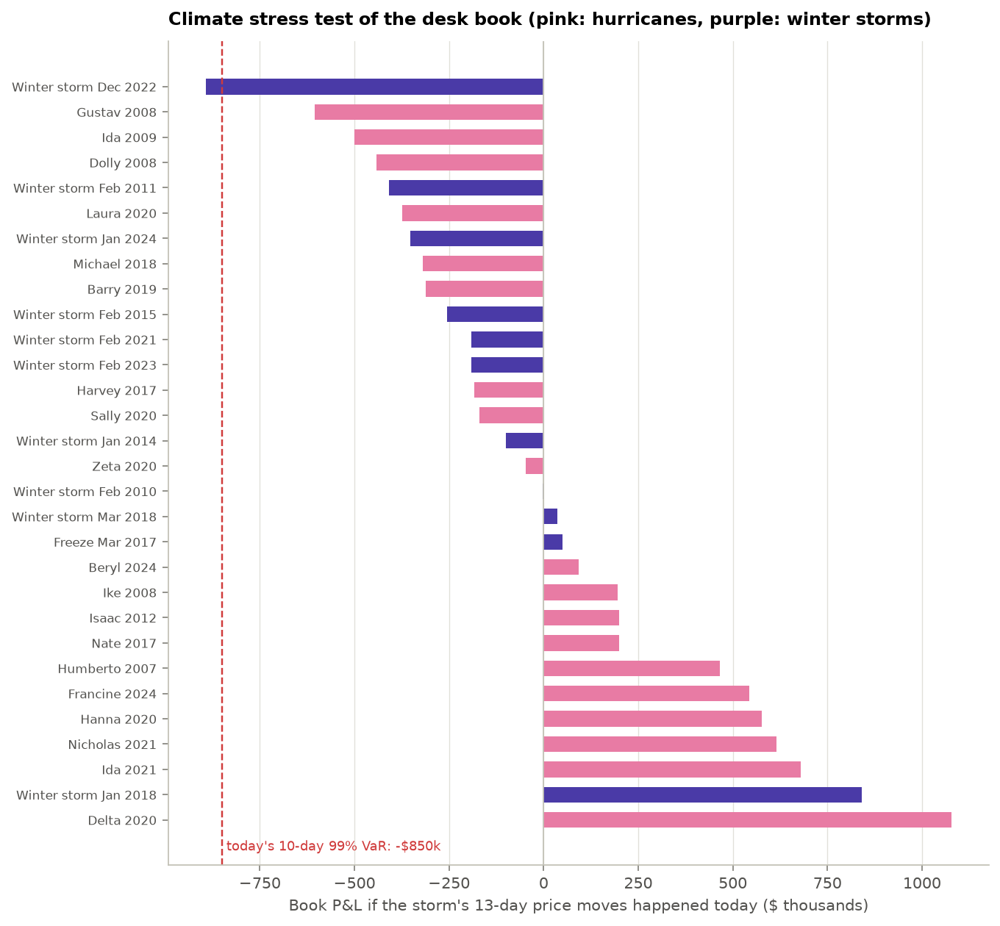

*Book P&L under every historical climate scenario.*

## Method notes, limitations and references

- Models come from the package `regime_risk` (regime-risk 1.0.0 (installed package)), the tested library of github.com/n9omi/regime-risk-and-model-validation; this project adds only the event logic, the event study and the overlay.
- Spot prices, not futures: spot Henry Hub reacts to same-day weather more than the front-month contract, which exaggerates gas moves relative to what a futures book would see.
- Event dates are physical, not the moment markets learned of them: forecasts move prices days earlier, which the run-up window [-5,-1] and the risk window starting at -2 only partly capture.
- NOAA stopped updating the billion-dollar database in 2025, so winter storms after 2024 are missing, including the late-January 2026 cold snap that produced the worst 13 days for a long gas position.
- 18 and 11 events are small samples: a single storm (February 2021) can move an average, which is why the placebo tests and per-event tables matter more than any one mean.
- The overlay assumes the risk manager knows about two trading days ahead that a named storm will hit; NHC and NWS watches usually give that, but its timing is idealised.

### References

- MacKinlay, A. C. (1997). Event studies in economics and finance. *Journal of Economic Literature*, 35(1).
- Brown, S. & Warner, J. (1985). Using daily stock returns: the case of event studies. *Journal of Financial Economics*, 14(1).
- Benjamini, Y. & Hochberg, Y. (1995). Controlling the false discovery rate. *JRSS B*, 57(1).
- Hamilton, J. (1989). A new approach to the economic analysis of nonstationary time series and the business cycle. *Econometrica*, 57(2).
- Barone-Adesi, G., Giannopoulos, K. & Vosper, L. (1999). VaR without correlations for portfolios of derivative securities. *Journal of Futures Markets*, 19(5).
- Bollerslev, T. (1987). A conditionally heteroskedastic time series model for speculative prices and rates of return. *Review of Economics and Statistics*, 69(3).
- Kupiec, P. (1995). Techniques for verifying the accuracy of risk measurement models. *Journal of Derivatives*, 3(2).
- Landsea, C. & Franklin, J. (2013). Atlantic hurricane database uncertainty and presentation of a new database format (HURDAT2). *Monthly Weather Review*, 141(10).
- Smith, A. & Katz, R. (2013). US billion-dollar weather and climate disasters: data sources, trends, accuracy and biases. *Natural Hazards*, 67(2).
- Basel Committee on Banking Supervision (1996). Amendment to the capital accord to incorporate market risks.
